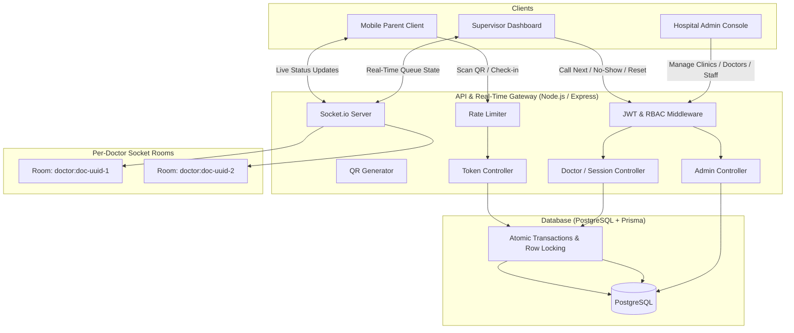
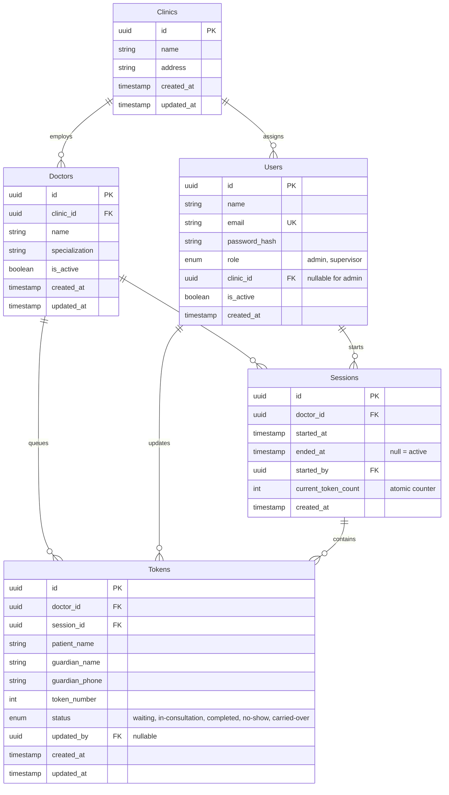

# Product Requirements Document (PRD) & Technical Architecture
## DigiQueue — Real-Time Token Management System for Children's Hospital

---

## 1. Executive Summary & Problem Context
Traditional paper-token queue systems in pediatric healthcare create significant operational and emotional friction:
- **Crowded Waiting Rooms & Infection Risk**: Immunocompromised infants and sick children are concentrated in cramped waiting areas for hours.
- **Lost Turns & Anxiety**: Guardians stepping outside to comfort crying or distressed children lose their turn when physical numbers are called out verbally.
- **Zero Visibility**: Families have no real-time insight into the number of patients ahead, creating frustration and repeated reception desk inquiries.
- **Operational Blindspots**: Clinic supervisors and hospital directors lack empirical data on doctor wait times, no-show rates, or session throughput.

**DigiQueue** replaces handwritten paper tokens with an atomic, high-concurrency, real-time digital queuing platform. Parents scan a doctor-specific QR code displayed at reception, submit a lightweight check-in form, and receive a live digital token with real-time status updates ("patients ahead of you", consultation calls, session alerts) powered by Socket.io. Staff and administrators get dedicated control dashboards to orchestrate clinic sessions and analyze pediatric flow.

---

## 2. System Architecture & Tech Stack



### Technology Matrix
| Layer | Technology | Rationale & Specifications |
| :--- | :--- | :--- |
| **Backend Runtime** | Node.js (v24 LTS/Active) | High event-loop throughput for I/O and WebSocket handling |
| **HTTP Framework** | Express.js | Clean MVC pattern, predictable routing, robust middleware |
| **Real-Time Layer** | Socket.io (v4) | WebSocket with fallback; isolated per-doctor rooms (`doctor:<doctorId>`) |
| **Database ORM** | PostgreSQL 18 + Prisma ORM | ACID transactions, strict schema constraints, connection pooling |
| **Frontend Framework** | React 18 / 19 + Vite | Fast HMR, reactive state management, mobile-first responsive rendering |
| **Styling & Design** | Tailwind CSS | Modern, calming pediatric aesthetic, responsive grid/flex layouts |
| **Validation Layer** | Zod + React Hook Form | Type-safe schema validation on both frontend forms and backend APIs |
| **Authentication** | JWT (`jsonwebtoken`) + `bcrypt` | Stateless bearer authentication; short-lived access tokens (15–30 min) |
| **QR Code Service** | `qrcode` | Server-side SVG/DataURL generation for reception-desk check-in stands |
| **Analytics Engine** | `recharts` | Responsive SVG charts for session wait times and daily patient volumes |
| **Protection Layer** | `express-rate-limit` | Concurrency and DDoS mitigation on unauthenticated public endpoints |

---

## 3. Database Schema & Data Models

The PostgreSQL database is managed via Prisma ORM with strict referential integrity and composite unique constraints:



### Key Integrity Rules & Indexes
1. **Composite Unique Constraint**: `@@unique([doctorId, sessionId, tokenNumber])` guarantees no duplicate tokens exist within the same session.
2. **Session Active State**: A doctor can have at most one open session at any given moment (`ended_at IS NULL`).
3. **Foreign Keys with Cascade Prevention**: Restrict deletion of doctors or clinics that have associated active tokens or audit histories.
4. **Performance Indexes**:
   - `CREATE INDEX idx_tokens_session_status ON Tokens (session_id, status);`
   - `CREATE INDEX idx_sessions_doctor_active ON Sessions (doctor_id) WHERE ended_at IS NULL;`
   - `CREATE INDEX idx_tokens_doctor_session_num ON Tokens (doctor_id, session_id, token_number);`

---

## 4. Concurrency & Atomic Token Issuance Model

### The Race Condition Challenge
During peak morning check-in rushes, dozens of guardians scan QR codes simultaneously. A naive calculation (`SELECT MAX(token_number) FROM Tokens`) risks multiple concurrent requests computing identical token numbers, triggering unique constraint collisions or missed queues.

### Atomic Row-Locking Implementation Strategy
In `POST /api/tokens/issue`:
```typescript
await prisma.$transaction(async (tx) => {
  // 1. Acquire row-level lock on the doctor's active session
  const [activeSession] = await tx.$queryRaw<Session[]>`
    SELECT id, doctor_id, current_token_count, ended_at 
    FROM "Sessions" 
    WHERE doctor_id = ${doctorId}::uuid AND ended_at IS NULL 
    FOR UPDATE
  `;

  if (!activeSession) {
    throw new ClinicNotAcceptingError("Clinic session is currently closed or inactive.");
  }

  // 2. Increment session counter atomically
  const nextTokenNumber = activeSession.current_token_count + 1;
  await tx.session.update({
    where: { id: activeSession.id },
    data: { current_token_count: nextTokenNumber },
  });

  // 3. Insert new token record
  const newToken = await tx.token.create({
    data: {
      doctorId,
      sessionId: activeSession.id,
      patientName,
      guardianName,
      guardianPhone,
      tokenNumber: nextTokenNumber,
      status: 'waiting',
    },
  });

  return { token: newToken, session: activeSession };
});
```
This guarantees **zero duplicate token numbers**, **zero skipped numbers**, and absolute consistency even under extreme concurrent bursts.

---

## 5. Socket.io Topology & Real-Time Event Protocol

To avoid broadcast storms and protect patient privacy, DigiQueue enforces **per-doctor rooms**:
- Room identifier: `doctor:<doctorId>`
- Patient sockets join only the room corresponding to their registered doctor: `socket.join('doctor:' + doctorId)`.
- Supervisors join the room(s) for doctors in their assigned clinic.
- System Admin can monitor multi-room feeds.

### Event Catalog
| Event Name | Direction | Payload | Trigger Condition |
| :--- | :--- | :--- | :--- |
| `token-issued` | Server -> Room | `{ tokenId, tokenNumber, doctorId, sessionId, queueLength }` | Patient check-in successfully committed |
| `queue-updated` | Server -> Room | `{ doctorId, sessionId, currentToken, waitingCount, aheadMap }` | Next called, status change, or new check-in |
| `token-called` | Server -> Room | `{ tokenId, tokenNumber, patientName, doctorId }` | Next patient called into consultation room |
| `token-no-show` | Server -> Room | `{ tokenId, tokenNumber, doctorId }` | Patient marked as absent/no-show |
| `session-reset` | Server -> Room | `{ doctorId, oldSessionId, newSessionId, message }` | Supervisor resets queue session |

### Graceful Session Reset Handling (Client-Side)
When a supervisor triggers `POST /api/doctors/:id/reset-session`:
1. The backend marks all remaining `'waiting'` tokens in the old session as `'carried-over'`.
2. A new session is created with `current_token_count = 0` (token numbering restarts at 1).
3. The server broadcasts `session-reset` to `doctor:<doctorId>`.
4. Any patient client currently viewing a token from `oldSessionId` immediately transitions its UI state:
   - Dismisses the active queue counter.
   - Displays a calming notice: *"This clinic session has concluded. If you need consultation, please re-scan the QR code at reception to join the new session."*
   - Prevents stale counter freezes.

---

## 6. Authentication, Authorization & Security Architecture

1. **Password Security**: Bcrypt with salt rounds = 12. Plaintext passwords never logged or persisted.
2. **JWT Specification**:
   - Signature algorithm: `HS256`.
   - Expiration: 30 minutes.
   - Payload: `{ userId, email, role: 'admin' | 'supervisor', clinicId }`.
3. **Role-Based Access Control (RBAC)**:
   - `requireAuth`: Validates JWT bearer token header.
   - `requireRole('admin')`: Restricts global clinic creation, doctor creation, and supervisor provisioning.
   - `requireClinicScope`: For supervisors, enforces that `actingUser.clinicId === resource.clinicId`. Supervisors cannot view or manipulate queues belonging to other clinics.
4. **Seed Provisioning**:
   - Strictly **no public signup** for admin or supervisor accounts.
   - Dedicated CLI command: `npm run seed:admin` using `.env` (`ADMIN_EMAIL`, `ADMIN_PASSWORD`).
   - Admins provision Supervisors via authenticated endpoint `POST /api/admin/supervisors`.
5. **Rate Limiting**:
   - Applied via `express-rate-limit` on public routes (`/api/tokens/issue`, `/api/tokens/:id/status`): 30 requests per minute per IP to prevent spam or token-enumeration attacks.

---

## 7. User Interface & Experience Architecture

### Visual Aesthetic & Design Tokens
- **Theme**: Calming Pediatric Healthcare (Clean slate backgrounds `#F8FAFC`, soft pediatric indigo `#4F46E5`, soothing emerald `#10B981` for active calls, soft amber `#F59E0B` for waiting).
- **Typography**: Inter / Outfit for ultra-legible numbers and headings.
- **Accessibility**: High-contrast token numbers, prominent mobile CTA buttons, large touch targets (min 48px), and screen-reader accessible status badges.
- **Audio Feedback**: Subtle Web Audio synthesized chime when a patient's token transitions to `'in-consultation'`.

### Three-Tier UX Layouts
```
+-------------------------------------------------------------------------+
| Tier 1: Patient Mobile View (/status/:tokenId)                         |
| +---------------------------------------------------------------------+ |
| | [ DigiQueue Pediatric Care ]                 Dr. Sarah Jenkins     | |
| |                                              Room 302 - Pediatric   | |
| | +-----------------------------------------------------------------+ | |
| | | YOUR TOKEN NUMBER                                               | | |
| | |                          # 14                                   | | |
| | | Status: [ Waiting ]                                             | | |
| | +-----------------------------------------------------------------+ | |
| | +-----------------------------------------------------------------+ | |
| | | Currently Serving: # 11                                         | | |
| | | Patients Ahead of You: [ 2 Patients ]                           | | |
| | | Estimated Wait: ~15 - 20 mins                                    | | |
| | +-----------------------------------------------------------------+ | |
| | [ Live WebSocket Connected Indicator ]                             | | |
| +---------------------------------------------------------------------+ |
+-------------------------------------------------------------------------+

+-------------------------------------------------------------------------+
| Tier 2: Supervisor Dashboard (/supervisor/dashboard)                   |
| +---------------------------------------------------------------------+ |
| | [ St. Jude Children's Clinic ]                  Logged in: Sarah (Sup)| |
| | Doctor: [ Dr. Sarah Jenkins v ]   Session: #SESS-892 (Started 09:00AM)| |
| |                                                                       | |
| | [ CALL NEXT PATIENT (#12) ]      [ MARK NO-SHOW ]   [ RESET QUEUE ]   | |
| |                                                                       | |
| | Currently In Consultation:                                            | |
| | Token #11: Ethan Davis (Age 4) | Guardian: Mark Davis (+1 555-0192)   | |
| |                                                                       | |
| | Waiting Queue (5):                                                    | |
| | [ #12 - Mia Robinson ] [ #13 - Liam Chen ] [ #14 - Noah Smith ] ...   | |
| |                                                                       | |
| | [ Analytics: Wait Time Distribution Chart (Recharts) ]               | |
| +---------------------------------------------------------------------+ |
+-------------------------------------------------------------------------+

+-------------------------------------------------------------------------+
| Tier 3: Hospital Admin Control (/admin/dashboard)                       |
| +---------------------------------------------------------------------+ |
| | [ DigiQueue System Admin ]                     Logged in: Admin       | |
| | +-----------------------------------------------------------------+ | |
| | | [ Clinics (3) ]  |  [ Doctors (12) ]  |  [ Supervisors (8) ]    | | |
| | +-----------------------------------------------------------------+ | |
| | + Add Clinic | + Provision Doctor | + Provision Supervisor Account  | |
| | [ System-Wide Cross-Clinic Analytics & Daily Patient Throughput ]     | |
| +---------------------------------------------------------------------+ |
+-------------------------------------------------------------------------+
```

---

## 8. System File Tree Structure

```
d:/DigiQueue/
├── package.json                         # Root orchestration & convenience scripts
├── .gitignore                           # Git ignore rules
├── implementation_plan.md               # Architecture PRD specification
│
├── server/                              # Backend Node.js / Express Application
│   ├── package.json
│   ├── .env.example
│   ├── prisma/
│   │   ├── schema.prisma                # PostgreSQL schema definitions
│   │   └── migrations/                  # Generated SQL migration history
│   ├── src/
│   │   ├── config/
│   │   │   ├── env.js                   # Environment variable loader & validator
│   │   │   ├── prisma.js                # Prisma client singleton instance
│   │   │   └── socket.js                # Socket.io initialization & room manager
│   │   ├── controllers/
│   │   │   ├── authController.js        # Login, current user resolution
│   │   │   ├── adminController.js       # Clinics, Doctors, Supervisors management
│   │   │   ├── doctorController.js      # Sessions, Reset, Next patient, Analytics
│   │   │   └── tokenController.js       # Atomic Issue, Status, No-show
│   │   ├── middleware/
│   │   │   ├── authMiddleware.js        # requireAuth, requireRole, requireClinicScope
│   │   │   ├── rateLimitMiddleware.js   # express-rate-limit configurations
│   │   │   └── validateMiddleware.js    # Zod payload validation middleware
│   │   ├── routes/
│   │   │   ├── authRoutes.js
│   │   │   ├── adminRoutes.js
│   │   │   ├── doctorRoutes.js
│   │   │   └── tokenRoutes.js
│   │   ├── services/
│   │   │   ├── qrService.js             # qrcode generator (SVG / Data URL)
│   │   │   ├── socketService.js         # Socket room broadcast helpers
│   │   │   └── tokenService.js          # Atomic queue transaction logic
│   │   ├── scripts/
│   │   │   └── seedAdmin.js             # Initial Admin, Clinic, Doctor, Session seeder
│   │   ├── app.js                       # Express app configuration & middleware
│   │   └── server.js                    # HTTP & Socket.io server bootstrap
│   └── tests/                           # Unit and concurrency verification scripts
│
└── client/                              # Frontend React + Tailwind Application
    ├── package.json
    ├── vite.config.js
    ├── tailwind.config.js
    ├── postcss.config.js
    ├── index.html
    └── src/
        ├── index.css                    # Tailwind directives & custom animations
        ├── main.jsx                     # React root mount
        ├── App.jsx                      # Client router & global providers
        ├── context/
        │   ├── AuthContext.jsx          # JWT state, login, logout
        │   └── SocketContext.jsx        # Socket.io connection & room lifecycle
        ├── components/
        │   ├── common/
        │   │   ├── Badge.jsx            # Queue status pills
        │   │   ├── Button.jsx           # Polished button with loading states
        │   │   ├── Card.jsx             # Glassmorphic containers
        │   │   ├── Modal.jsx            # Confirmations (Reset queue, etc.)
        │   │   └── Navbar.jsx           # Global header with clinic badge & logout
        │   ├── patient/
        │   │   ├── CheckInForm.jsx      # Mobile check-in form with Zod validation
        │   │   └── TokenStatusCard.jsx  # Live queue tracker with animated ahead count
        │   ├── supervisor/
        │   │   ├── QueueController.jsx  # Next, No-show, Reset buttons
        │   │   ├── WaitingQueueList.jsx # Live list of queued patients
        │   │   ├── ActiveTokenBanner.jsx# Prominent in-consultation card
        │   │   └── AnalyticsView.jsx    # Recharts wait-time & throughput charts
        │   └── admin/
        │       ├── ClinicManager.jsx    # Provision clinics
        │       ├── DoctorManager.jsx    # Provision doctors & view QR codes
        │       └── SupervisorManager.jsx# Create supervisors with clinic binding
        ├── hooks/
        │   ├── useAudioAlert.js         # Synthesized audio chime on call
        │   └── useDoctorQueue.js        # Socket-driven queue synchronization
        ├── pages/
        │   ├── CheckInPage.jsx          # /checkin/:clinicId/:doctorId
        │   ├── TokenStatusPage.jsx      # /status/:tokenId
        │   ├── LoginPage.jsx            # /login
        │   ├── SupervisorPage.jsx       # /supervisor
        │   └── AdminPage.jsx            # /admin
        └── services/
            ├── api.js                   # Axios / Fetch client with auth interceptors
            └── socket.js                # Socket.io client singleton
```

---

## 9. Verification & Automated Testing Plan

### Pre-requisites & Environment Readiness
1. **Database Readiness**:
   - PostgreSQL 18 connection verified and tested.
   - Connection configured in `server/.env` using isolated schema `digiqueue`.
   - Schema deployed via `npx prisma db push`.
2. **Seed Execution**:
   - Run `npm run seed:admin` in `server/`.
   - Confirms creation of:
     - 1 Admin account (`admin@digiqueue.local`)
     - 1 Clinic (`Sunshine Children's Clinic`)
     - 1 Doctor (`Dr. Maya Lin - Pediatric Specialist`)
     - 1 Supervisor account (`supervisor@digiqueue.local`) assigned to Sunshine Clinic
     - 1 Open Active Session for Dr. Maya Lin.

### Automated Browser Subagent Verification (Step 8 Execution)
We will launch an automated browser session simulating:
1. **Client A (Patient 1)**:
   - Navigates to `/checkin/:clinicId/:doctorId`.
   - Enters Patient: *"Leo Parker (Age 3)"*, Guardian: *"Emma Parker"*, Phone: *"555-0101"*.
   - Submits form -> redirects to `/status/:tokenId` -> Receives **Token #1**.
   - Ahead counter displays: `0 Patients ahead of you`.
2. **Client B (Patient 2)**:
   - Enters Patient: *"Zara Khan (Age 5)"*, Guardian: *"Tariq Khan"*, Phone: *"555-0102"*.
   - Submits form -> redirects to `/status/:tokenId` -> Receives **Token #2**.
   - Ahead counter displays: `1 Patient ahead of you`.
3. **Supervisor View**:
   - Logs into `/login` with supervisor credentials.
   - Observes active queue with Token #1 and Token #2 in real time.
   - Clicks **"Call Next"**:
     - Token #1 transitions to `'in-consultation'`.
     - Patient 1 view instantly displays *"YOUR TURN! Please proceed to Consultation Room"* with audio chime.
     - Patient 2 view updates: `0 Patients ahead of you` in real time without page reload.
4. **Session Reset Test**:
   - Supervisor clicks **"Reset Queue"**, confirms modal dialog.
   - Patient 1 & Patient 2 live views immediately display session ended notification.
   - Patient 3 checks in -> Receives **Token #1** in the new session.

---

## 10. Implementation Phases & Milestones

- **Phase 1**: Backend Foundation (Prisma schema, migrations, seed script, Express app setup).
- **Phase 2**: Atomic Token Engine & Real-Time Socket Architecture (Row locking, room events).
- **Phase 3**: Authentication & Role-Based Controllers (JWT, RBAC, Admin/Supervisor endpoints).
- **Phase 4**: Frontend Foundation & Design System (Vite, Tailwind, Component library).
- **Phase 5**: Three-Tier User Interfaces (Patient QR Check-in & Live Status, Supervisor Dashboard, Admin Control).
- **Phase 6**: End-to-End Verification & Automated Browser Testing.
